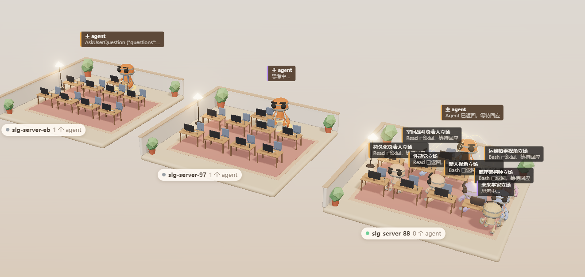

# agentwatch

中文 | [English](README.en.md)



当前用户所有工作目录下 Claude Code 与 Codex 会话的实时 3D 看板，一个会话一个房间。Go 标准库扫描两处日志，每秒经 SSE 推送快照；前端是无构建的 Three.js 温馨低多边形等距办公室，按工作目录把房间与侧栏分组，顶部页签可切到「全部」或单个工作目录，点房间名牌上的 ⛶ 可只显示该房间并拉近（再点一次或按 Esc 退出），Codex 房间的名牌与侧栏会标出 `Codex`。

- Claude Code：`~/.claude/sessions/*.json` 注册表；默认只显示注册表里进程还活着的会话。加 `-all` 才额外回放 `~/.claude/projects/*/*.jsonl` 中最近 `-history` 内改动过的会话与子 agent 日志。
- Codex：`~/.codex/sessions/YYYY/MM/DD/rollout-*.jsonl`，房间归到 `session_meta.cwd` 对应的工作目录，房间名取 `~/.codex/session_index.jsonl` 的线程名。Codex 只画主 agent，没有子 agent 与纸飞机；没有进程注册表，按最近事件时间判断忙闲。

## 运行

```bash
# 启动后扫描当前用户全部工作目录，自动打开浏览器
~/tools/agentwatch/start.sh

# 换端口
AGENTWATCH_PORT=7788 ~/tools/agentwatch/start.sh

# 假数据（三个房间、两个工作目录、状态循环），用于调前端
cd ~/tools/agentwatch && go run . -demo -port 7799
```

参数：`-port` 默认 7788，`-stuck` 默认 120s，`-ghost` 默认 180s，`-aliases` 默认 `aliases.json`，`-history` 默认 24h（`-all` 时日志早于它的会话不显示，看老会话就调大，如 `-all -history 720h`）；`-all` 默认关闭且只影响 Claude，只显示有活进程的会话，已结束与纯历史的房间不显示。服务固定扫描 `$HOME` 下的全部工作目录。

## 作为插件安装

本仓库同时是 Claude Code 与 Codex 的插件 marketplace，插件在 `plugins/agentwatch/`。装好后对 agent 说「打开 agentwatch」，或在 Claude Code 里用 `/agentwatch`，它会运行 `plugins/agentwatch/scripts/ensure-server.sh`：当前用户已有服务就复用，否则后台起服务（日志 `log/agentwatch.log`），最后给出 URL。

```bash
# Claude Code：安装范围 user（默认）/ project / local，界面语言 zh / en
claude plugin marketplace add QuanjieDeng/agentwatch
claude plugin install agentwatch@agentwatch --scope project --config language=zh

# Codex
codex plugin marketplace add QuanjieDeng/agentwatch
codex plugin add agentwatch@agentwatch
```

在 Claude Code 的 `/plugin` 里交互式安装时，会直接询问安装范围和界面语言；命令行安装用 `--scope` 与 `--config language=` 指定。安装范围决定插件写进哪份设置：`user` 全局、`project` 随仓库共享、`local` 只在本仓库生效。语言装好后可用 `claude plugin configure agentwatch` 修改，重新运行 `/agentwatch` 即可拿到带 `?lang=` 的新地址。直接 `go run .` 运行时看板按浏览器语言选择，也可以手动加 `?lang=en` 或 `?lang=zh`。

首次运行时本机还没有源码，脚本会自动浅克隆本仓库到 `~/tools/agentwatch`（要换位置就设 `AGENTWATCH_HOME`），所以 PATH 里需要 `go`、`git` 与 `curl`。之后更新源码用 `git -C ~/tools/agentwatch pull`。本地开发想直接装当前目录，把上面的仓库换成 `~/tools/agentwatch` 即可。

脚本读 `AGENTWATCH_PORT`（默认 7788）、`AGENTWATCH_HOME`（源码位置）与 `AGENTWATCH_LANG`（界面语言 `zh` / `en`）。插件不带 hook。

## 状态与动画

| 状态 | 动画 |
|------|------|
| `thinking` | Idle，站在工位旁轻晃 |
| `tool` | Sitting，坐下对着显示器干活，一会打字一会用鼠标，台灯变琥珀色 |
| `processing` | Yes，站起来点头读结果 |
| `idle` | 躺进椅子里呼呼大睡，头顶飘 Zzz；没有工位的 agent 站着 |
| `stuck` | No，摇头，头顶红色感叹号，工位灯与光环红色脉冲 |
| `done` | Wave 或 ThumbsUp，走向门口变灰成幽灵 |

每个房间的中央后方有一张工头桌，主 agent 也按同一套状态表坐下或起立。

agent 之间发消息时会飞过一架纸飞机：主 agent 派活给子 agent、子 agent 交回结果，以及 `SendMessage` 发给别的会话（跨房间飞）。

## 会话别名

在 `aliases.json` 里给 session 起别名，按 sessionId 或会话名（Claude Code 会话名 / Codex 线程名）匹配，服务端每秒热读，改完即可生效。仓库只带 `aliases.example.json`，复制成 `aliases.json` 再改（该文件已被 git 忽略，不会把私人会话名提交上去）：

```json
{
  "slg-server-a0": "3D 监控台",
  "2695dfe4-e519-4dd9-8458-0f065b7c1107": "登录排查"
}
```

房间名牌与侧栏优先显示别名，原始会话名以小字保留在侧栏。

## 目录

- `model.go` 快照/房间/agent/事件类型
- `scanner.go` 项目定位、会话发现、jsonl 增量读取、状态推导
- `codex.go` Codex rollout 发现与状态推导，复用 `scanner.go` 的增量读取
- `main.go` flag、两端快照合并、HTTP、SSE、静态文件
- `demo.go` 演示数据
- `web/` 前端；`web/vendor/three` 是 vendored three.js，`web/assets/RobotExpressive.glb` 是 CC0 角色
- `web/nav.js` 房间地面导航：家具挖成障碍，A* 绕行；角色走动时互相推让。检查：`node --test web/nav.test.mjs`
- `PROTOCOL.md` 前后端契约
- `plugins/agentwatch/`、`.claude-plugin/`、`.agents/plugins/` 双端插件与 marketplace 清单

## 已知限制

- 服务无鉴权且监听所有网卡（`:port`），看板会暴露 `$HOME` 下所有会话的提问、命令与文件路径。只在可信网络使用，或自己用防火墙限制端口。
- `-all` 加很大的 `-history` 时房间会非常多（720h 在本机是数百个），场景会拥挤，首屏扫描也会变慢；默认只显示活会话，`-history` 为 24h。
- 每个房间 8 个工位，超出部分站在门口且不画连线。
- 标签没有碰撞处理，agent 很多时会重叠。
- 角色模型升级 three.js 时要同时更新 `web/vendor/three/build/three.module.js` 与 `three.core.js`，r186 起前者依赖后者。
- session 注册表 `status` 若停在 `busy`，主 agent 静默超过 `-stuck` 会显示卡住。
- Codex 只有主 agent：日志里还没有可对上的子 agent 元数据，所以没有工位和纸飞机。
- Codex 没有进程注册表，单次工具调用超过 `-stuck`（默认 120 秒）没有新事件时会显示 idle，而不是 stuck。

## License

MIT，见 [LICENSE](LICENSE)。
